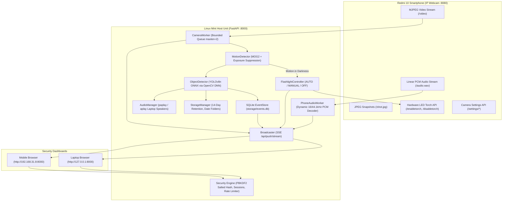

# 🛡️ PySURVEILLANCE — Intelligent Field Surveillance & Security Console
**Platform:** Linux Mint / Ubuntu LTS (Host: HP EliteBook 745 G2)  
**Edge Sensor Hardware:** Xiaomi Redmi 10 Smartphone (IP Webcam v0.4+)  
**Version:** 2.0.0 (Master Security & Sensor Upgrade)

---

## 📋 System Architecture

PySURVEILLANCE is an edge-first surveillance and perimeter defense platform that utilizes an Android smartphone (Redmi 10) as its dedicated camera, microphone, and hardware LED flashlight, while executing motion analysis, neural network object detection, automated lighting control, and audible alarms on a host Linux laptop.



---

## 🌟 Upgraded Subsystems & Features

### 1. Dedicated Phone Microphone Integration (Phase 2)
* **Exclusive Phone Audio Source:** Directly streams and decodes uncompressed linear PCM audio from `http://<PHONE_IP>:8080/audio.wav`.
* **Strict Source Policy:** The host laptop's local sound card and browser `getUserMedia()` are completely excluded. If the phone audio stream drops, the system clearly reports `PHONE AUDIO: DISCONNECTED`.
* **Dynamic Waveform Discovery:** Automatically parses the RIFF/WAV header to determine sample rate (e.g. 16kHz, 44.1kHz, 48kHz) and channel geometry on connection.
* **Ambient Noise-Floor Tracking:** Computes real-time RMS energy and exponential moving average (EMA) ambient noise floors, distinguishing quiet background hum from sudden footsteps or voices.

### 2. Intelligent Flashlight Automation (Phase 3)
* **Motion-Only Triggering in Darkness:** Motion detection under low-light threshold (< 45 lux) automatically commands the Redmi 10 LED flashlight ON.
* **Strict Independence:** Audio activity does **NOT** independently activate the flashlight.
* **15-Second Inactivity Reset:** Continuous qualifying motion actively resets the countdown timer. When motion ceases, the flashlight turns off after 15 seconds.
* **Overheating Protection:** Hard safety maximum ON cutoff (120s) and minimum stabilization duration (10s).
* **Manual Overrides:** `AUTO`, `FORCE ON`, and `FORCE OFF` with independent tracking of verified hardware status versus requested status.

### 3. Security Hardening & Authentication (Phase 4)
* **Cryptographic PIN Storage:** PBKDF2-HMAC-SHA256 with 100,000 iterations and unique random 16-byte salt. Plaintext PINs are never stored or logged.
* **Session Lifecycle:** 24-hour expiring cryptographically generated tokens with client IP consistency verification.
* **Brute-Force Rate Limiting:** 5 consecutive failed attempts trigger an automatic 5-minute IP lockout (HTTP 429).
* **Firewall Enforcement:** Rejects non-LAN / external traffic by default, permitting only loopback and private subnets (`192.168.*`, `10.*`, `172.16.*`).
* **Endpoint Protection:** All state-changing operations require authenticated session tokens or PIN headers.

### 4. Modern Dark Security Console UI (Phase 5)
* **Unified Visual Identity:** Coherent high-tech surveillance branding with SVG shield aperture and zero legacy placeholders.
* **10 Structured Sections:**
  1. Overview & Top Subsystem Bar (Camera, Phone Audio, Database, Sleep Inhibitor, Push).
  2. Live Camera Monitoring with multiplexed MJPEG, fast Canvas refresh, and telemetry overlays.
  3. Camera Hardware Controls & Software Tone Mapping (Exposure compensation, contrast, gamma LUT).
  4. Dedicated Flashlight Automation Card with real-time 15s countdown progress bar and circular event history.
  5. Dedicated Phone Audio Monitoring Card with dynamic color-graded RMS meter bar and noise floor diagnostics.
  6. Detection Statistics Panel.
  7. Latest Incident Showcase with side-by-side Initial/Final image comparisons.
  8. Recorded Incident History (Timeline & Gallery views with filter tabs).
  9. System Diagnostics Modal with comprehensive subsystem health status.
  10. PIN Security & System Settings.

### 5. Database, Storage & Backup (Phases 6–8)
* **SQLite Integrity & Persistence:** Table `events` preserves incident history across reboots.
* **Point-in-Time Hot Backup:** SQLite Online Backup API creates consistent point-in-time snapshots (`POST /api/storage/backup`) into `storage/backups/`.
* **Automated Retention:** 14-day rolling retention and storage quotas protect active, ongoing incidents from deletion.

---

## 🔒 Recommended Remote Access Configuration (WireGuard & Tailscale)

PySURVEILLANCE strictly enforces local network isolation and prohibits direct port forwarding of port 8000 or camera port 8080 to the public internet.

To access the security console remotely when away from the home Wi-Fi network:

### Option A: Tailscale (Easiest & Zero-Port-Forwarding)
1. Install Tailscale on the Linux Mint laptop:
   ```bash
   curl -fsSL https://tailscale.com/install.sh | sh
   sudo tailscale up
   ```
2. Install Tailscale on your mobile phone / client device and sign in with the same account.
3. Access the dashboard from anywhere using the laptop's private 100.x.y.z Tailscale IP:
   `http://100.x.y.z:8000`
   *(Because Tailscale operates as an encrypted overlay VPN, traffic remains end-to-end encrypted and completely private).*

### Option B: WireGuard Peer-to-Peer
1. Configure a WireGuard interface (`wg0`) with private subnet (e.g. `10.8.0.0/24`).
2. Bind PySURVEILLANCE to `0.0.0.0:8000`. The internal security middleware recognizes `10.8.0.x` as a valid private network IP.
3. Connect your mobile phone to the WireGuard tunnel and open `http://10.8.0.1:8000`.

---

## 🚀 How to Run PySURVEILLANCE

### 1. Start IP Webcam on Redmi 10
1. Open **IP Webcam** on the Redmi 10 smartphone.
2. Tap **"Start server"** at the bottom.
3. Note the IP address displayed on the screen (e.g. `http://192.168.31.211:8080`).

### 2. Launch the Application on the Laptop
```bash
cd /home/sumit/Desktop/survelance
.venv/bin/python run.py
```

### 3. Access the Dashboard
* **Laptop:** [http://127.0.0.1:8000](http://127.0.0.1:8000)
* **Phone / LAN:** `http://192.168.31.8:8000` (Scan the QR code displayed in the dashboard header).
* **Default PIN:** `1234` (Can be changed in the Settings modal).

### 4. Run Acceptance Verification Suite
```bash
cd /home/sumit/Desktop/survelance
.venv/bin/python test_pysurveillance_master.py
```
