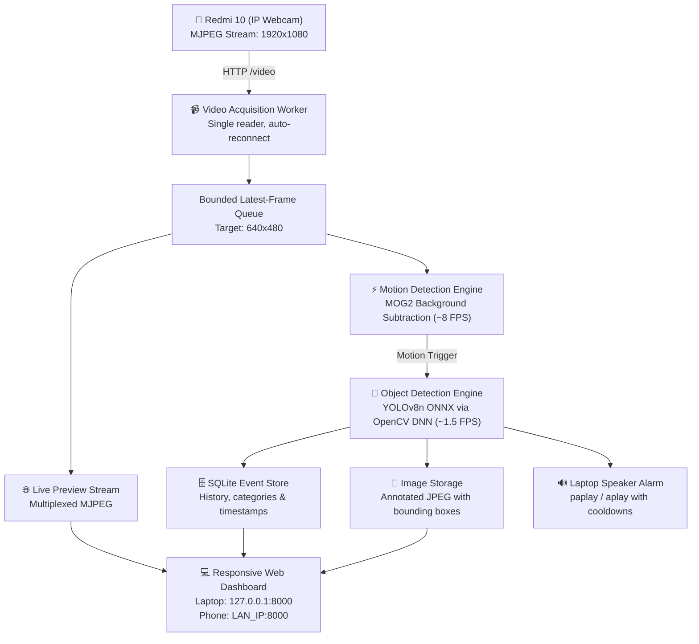

# 🌾 WHEAT WATCH — Field Surveillance & Crop Defense System

Wheat Watch is an autonomous, real-time perimeter monitoring and crop security system. It leverages a standard Android smartphone (such as a Redmi 10 running the IP Webcam app) as an edge camera, while running AI motion detection, object classification, event recording, and laptop-side audio deterrence on a Linux laptop.

---

## 📋 Architecture & Core Features



1. **Decoupled Asynchronous Processing Pipeline**:
   - **Video Acquisition**: Only one connection to the phone camera is opened. Frames are scaled to 640x480.
   - **Bounded Latest-Frame Buffer**: Prevents frame latency accumulation.
   - **Live Preview Multiplexing**: Multiple browser clients can watch the live feed simultaneously without straining the phone camera.
   - **Motion Detection**: Runs MOG2 background subtraction at 5–10 FPS using low CPU.
   - **AI Inference**: Triggers on motion at 1–2 FPS using YOLOv8n ONNX.
   - **Laptop-Side Audio Alarms**: Uses Linux `paplay` directly on laptop speakers. Runs even with the browser closed.
   - **Sleep Prevention**: Inhibits laptop suspension while monitoring is active via `systemd-inhibit`.

2. **Classification Rules & Ethics**:
   - **Person**: Detected without facial recognition or identity tracking.
   - **Bird**: Identified as avian crop pests.
   - **Animal Policy**: Standard COCO models cannot reliably verify monkeys. All animal detections report as **"Animal detected — species unconfirmed"** unless a verified custom monkey model is installed.
   - **Possible Monkey**: Pluggable slot for verified monkey classifiers (`models/monkey_classifier.onnx`).
   - **General Motion / Unknown Object**: Logged and alarmed with lower priority tones.

3. **Dashboard Accessibility & Security**:
   - Binds to `0.0.0.0:8000`.
   - Accessible on laptop at `http://127.0.0.1:8000`.
   - Accessible on phone at `http://LAPTOP_LAN_IP:8000` (e.g. `http://192.168.31.8:8000`).
   - QR Code display for instant one-click phone connection.
   - Configurable PIN protection (Default: `1234`).
   - Local network restriction middleware rejects any non-LAN / public traffic.

---

## 🚀 Quick Start Guide

### 1. Prerequisites on Linux Mint / Ubuntu Laptop
Wheat Watch requires Python 3.10+, OpenCV, FastAPI, and `paplay` (installed by default on Linux Mint).
All dependencies are pre-configured in `.venv`.

### 2. Configure Redmi 10 (IP Webcam)
1. Install **IP Webcam** from Google Play Store on the Redmi 10.
2. Connect the phone to the same Wi-Fi network as the laptop.
3. Open **IP Webcam**, scroll to the bottom, and tap **"Start server"**.
4. Note the displayed IP address (e.g., `http://192.168.31.211:8080`).

### 3. Launch Wheat Watch
In terminal:
```bash
cd /home/sumit/Desktop/survelance
.venv/bin/python run.py
```

The terminal will display:
```text
========================================================================
🌾 WHEAT WATCH — Autonomous Field Surveillance & Crop Defense System
========================================================================
 [✓] Local Network Binding : 0.0.0.0:8000
 [✓] Laptop Access URL     : http://127.0.0.1:8000
 [✓] Phone Dashboard URL   : http://192.168.31.8:8000
 [✓] Target Phone Camera   : http://192.168.31.211:8080/video
 [✓] Audio Engine Active   : Laptop system speakers (paplay/aplay)
 [✓] Power Manager         : systemd-inhibit active monitoring
========================================================================
```

### 4. Open the Dashboard
- **On Laptop**: Open `http://127.0.0.1:8000` in Google Chrome or Firefox.
- **On Phone**: Scan the QR code from the dashboard or navigate to `http://192.168.31.8:8000`.

---

## ⚙️ Configuration Reference (`wheat_watch_config.json`)

Settings can be edited dynamically in the Dashboard UI (Settings ⚙️) or directly in `wheat_watch_config.json`:

| Section | Parameter | Default | Description |
|---|---|---|---|
| `camera` | `phone_ip` | `192.168.31.211` | Local IP address of Redmi 10 |
| `camera` | `phone_port` | `8080` | Port configured in IP Webcam |
| `camera` | `video_endpoint` | `/video` | MJPEG video stream route |
| `camera` | `snapshot_endpoint` | `/shot.jpg` | Single frame capture route |
| `server` | `dashboard_pin` | `1234` | PIN to unlock admin actions |
| `pipeline` | `motion_fps` | `8.0` | Target motion detection FPS |
| `pipeline` | `ai_fps` | `1.5` | Target AI inference rate on motion |
| `pipeline` | `auto_throttle_cpu` | `true` | Dynamically reduce FPS if CPU > 85% |
| `push` | `enabled` | `true` | Force push messages to connected browsers |
| `push` | `desktop_notifications` | `true` | Native OS / browser notification popups |
| `push` | `browser_audio` | `true` | Play web audio chimes on connected browsers |
| `alarm` | `sound_enabled` | `true` | Enable laptop-side speakers |
| `power` | `prevent_sleep` | `true` | Prevent laptop sleep during monitoring |

---

## 🛠️ Linux Mint Autostart (systemd User Service)

To start Wheat Watch automatically upon user login:

```bash
cd /home/sumit/Desktop/survelance
./setup_service.sh
systemctl --user enable --now wheat-watch.service
```

Useful management commands:
- Check status: `systemctl --user status wheat-watch.service`
- Stop service: `systemctl --user stop wheat-watch.service`
- View live logs: `journalctl --user -u wheat-watch.service -f`

---

## 🔍 Troubleshooting Guide

### 1. Camera Status Shows "RECONNECTING" or "DISCONNECTED"
- **Cause**: IP Webcam server is stopped or phone IP changed via DHCP.
- **Solution**:
  1. Open IP Webcam on the Redmi 10 and ensure "Start server" is running.
  2. Verify phone IP address on the phone screen.
  3. Click **Settings ⚙️** on the Wheat Watch dashboard, update the Phone IP, and click **"Test Camera Connection"**.
  4. The system will auto-reconnect once the IP is restored.

### 2. Dashboard Unreachable from Phone Browser
- **Cause**: Laptop and Phone are on isolated Wi-Fi AP isolation or firewall blocking port 8000.
- **Solution**:
  1. Verify both devices are on the same Wi-Fi SSID.
  2. Test laptop LAN reachability from phone: ping `192.168.31.8`.
  3. Ensure UFW allows local connections: `sudo ufw allow in on wlo1 to any port 8000 proto tcp`.

### 3. No Sound Coming from Laptop Speakers
- **Cause**: Audio output muted or PipeWire/PulseAudio session suspended.
- **Solution**:
  1. Click **"Test Laptop Alarm"** in the dashboard.
  2. Check volume slider in Linux Mint system tray.
  3. Verify test in terminal: `paplay sounds/test.wav`.

### 4. High CPU Load / Laptop Fan Spinning
- **Cause**: Continuous high-resolution video decoding on older dual/quad-core CPUs.
- **Solution**:
  1. `auto_throttle_cpu` is enabled by default and automatically drops inference rates if CPU exceeds 85%.
  2. Lower **Motion Target FPS** in settings from 8 to 5.
  3. Lower **AI Inference FPS** in settings from 1.5 to 1.0.

### 5. Forgot Dashboard PIN
- **Solution**: Open `wheat_watch_config.json`, locate `"dashboard_pin": "..."`, change it back to `"1234"`, and save.
