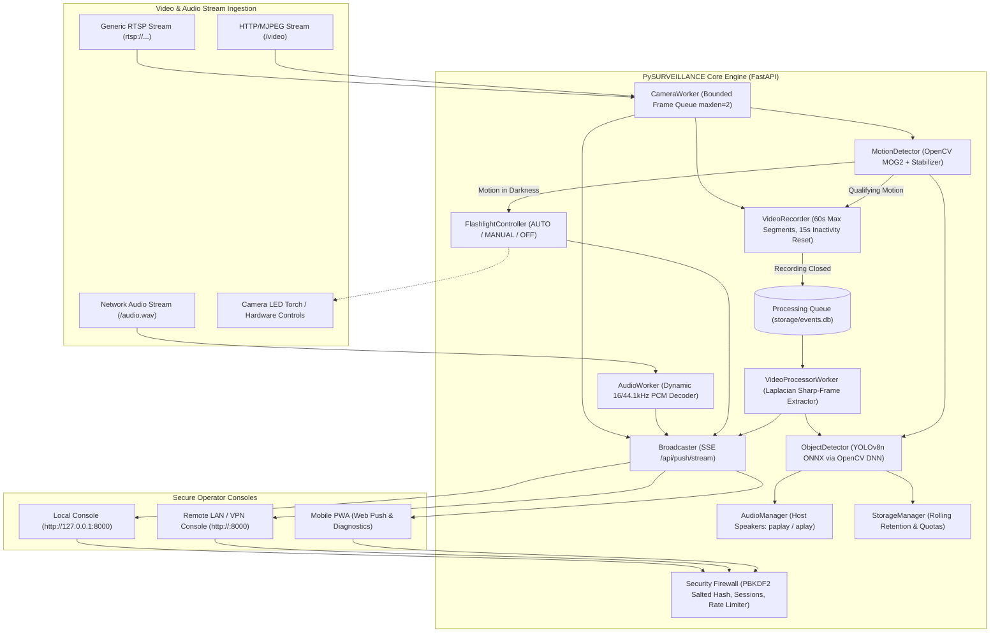
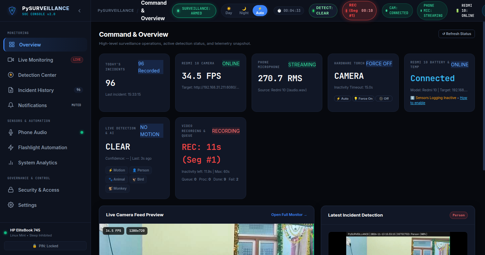
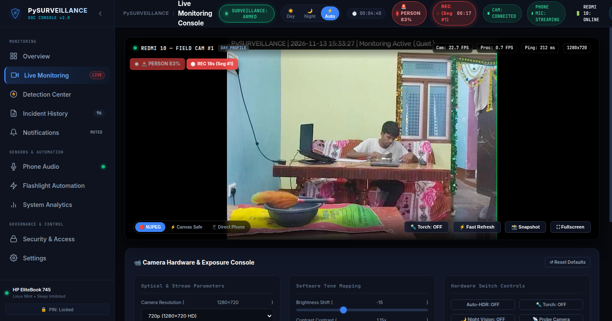
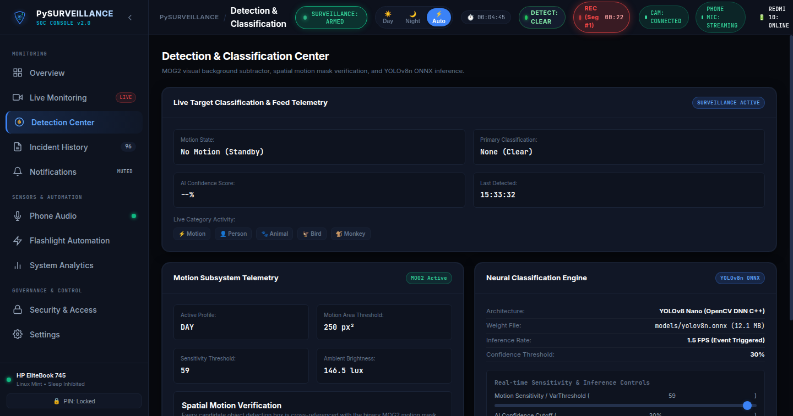
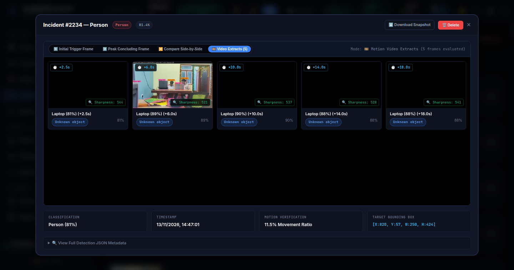
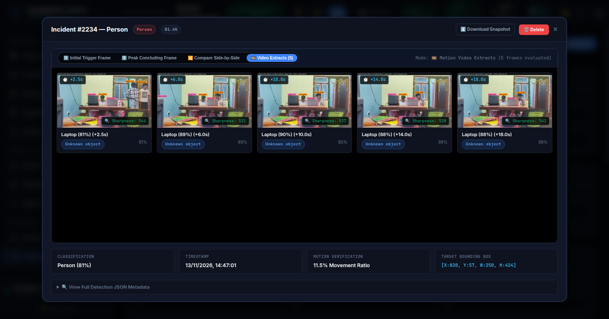
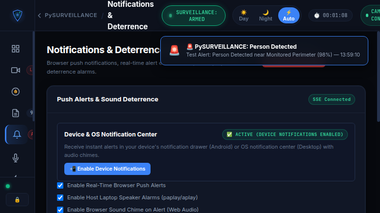

# 🛡️ PySURVEILLANCE — Intelligent Edge Surveillance & Defense Console

**Version:** 2.1.0 (Hardware-Independent & Security-Hardened Release)  
**Supported Host Operating Systems:** Linux (Ubuntu 22.04/24.04+, Debian 12+, Linux Mint 21/22+, Raspberry Pi OS 64-bit)  
**Python Runtime:** Python 3.10, 3.11, 3.12, 3.13  
**Tested Reference Hardware:**
- **Host System:** Linux x86_64 Laptop / Mini PC (Tested: AMD A10 PRO-7350B, 4 cores, 8 GB RAM)
- **Reference Camera:** Android Smartphone running IP Webcam v0.4+ / Generic ONVIF & RTSP H.264 / MJPEG IP Cameras

---

## 📋 System Overview

**PySURVEILLANCE** is an edge-first, resource-conscious intelligent surveillance and perimeter defense platform. It decouples high-resolution network video and audio acquisition from asynchronous neural object detection, visual motion background subtraction, intelligent lighting automation, and incident forensics.

### Key Operational Capabilities
- **Universal Stream Ingestion:** Connects to standard HTTP/MJPEG streams, RTSP video streams, and uncompressed linear PCM network audio without proprietary vendor locks.
- **Motion-Triggered Video Recording:** Starts video capture immediately upon qualifying camera motion without waiting for neural inference.
- **Decoupled Incident Processing Queue:** Enqueues recorded video segments (`QUEUED`), extracts high-sharpness forensic frames using Laplacian variance, and performs YOLOv8n object classification in a background worker without blocking live surveillance.
- **Hardware-Adaptive Lighting Automation:** Controls external LED illumination or phone hardware torches automatically upon detecting motion in darkness with a 15-second continuous-motion reset timer.
- **Zero-Backdoor Cryptographic Security:** First-run master PIN setup hashed via PBKDF2-HMAC-SHA256 (100,000 iterations), brute-force IP lockout, and strict local network (RFC 1918) firewalling.
- **Zero-Cloud Incident Retention:** Self-contained SQLite database with point-in-time hot backups, automated rolling retention, and browser push notifications.

---

## 🏗️ Architecture & Data Flow



---

## 📸 Program Interface & Screenshots

### 1. Security Operations Center (SOC) Command & Overview
The centralized operator dashboard displaying live camera and audio connection status, host and sensor hardware telemetry, 8-state motion video recording engine, and real-time detection & AI classification cards.



---

### 2. Live Cinema Monitoring & Floating HUD
High-framerate video monitoring workspace with floating detection alerts (`🚨 PERSON 83%`), recording status HUD (`REC 18s (Seg #1)`), stream format selection (MJPEG/Canvas), and software tone mapping controls (gamma LUT, exposure compensation, contrast).



---

### 3. Detection & Classification Center
Live target tracker synchronizing MOG2 background subtraction with YOLOv8n ONNX deep learning inference, spatial verification masks, and real-time sensitivity sliders.



---

### 4. Forensic Incident Inspection & High-Sharpness Extracts
Chronological multi-frame incident inspection displaying initial trigger, peak change, and concluding snapshot evidence alongside Laplacian variance-scored high-sharpness video extractions.



---

### 5. Hardware Controls, Audio & Automation Settings
Comprehensive system configuration covering video segment duration caps, inactivity timers, network stream endpoints, and cryptographic PIN access control.



---

### 6. Native Device & Browser Notification Center
Audited event delivery channel dispatching instant alerts with snapshot thumbnails to desktop and mobile notification centers via Service Workers and SSE streams.



---

## ⚙️ Hardware Independence & Sensor Compatibility

PySURVEILLANCE does not depend on proprietary hardware. Any modern Linux machine and any network-accessible video/audio feed can be utilized.

### 1. Host Machine Requirements
- **Processor:** x86_64 or ARM64 (AMD, Intel, Raspberry Pi 4/5, Rockchip).
- **RAM:** Minimum 2 GB (4 GB+ recommended for continuous multi-stream analysis).
- **Storage:** 10 GB+ available disk space for incident retention.
- **Audio Output (Optional):** PulseAudio, PipeWire, or ALSA system output for host-side acoustic deterrence.

### 2. Camera & Video Source Support
| Device Profile | Supported Video Protocols | Audio Protocol | Hardware Lighting | Telemetry Support |
|---|---|---|---|---|
| **Auto-Detect / IP Webcam** | HTTP MJPEG (`/video`), JPEG Snapshot (`/shot.jpg`) | Linear PCM WAV (`/audio.wav`) | Supported (`/enabletorch`, `/disabletorch`) | Battery %, Battery Temp, Voltage, Optics |
| **Generic IP Camera / RTSP** | RTSP (`rtsp://user:pass@ip:554/h264`), HTTP MJPEG | HTTP PCM WAV or separate audio stream | Cleanly reported as "Unsupported / N/A" | Reported as "External Power (AC/PoE)" |

---

## 🔧 Installation & Setup

### 1. Prerequisites
On Ubuntu / Debian / Linux Mint:
```bash
sudo apt update
sudo apt install -y python3 python3-pip python3-venv git pulseaudio-utils libgl1-mesa-glx
```

### 2. Clone the Repository
```bash
git clone https://github.com/ss3325713/survelance.git pysurveillance
cd pysurveillance
```

### 3. Create Python Virtual Environment
```bash
python3 -m venv .venv
source .venv/bin/activate
pip install --upgrade pip
pip install -r requirements.txt
```

### 4. Configure Initial Settings
Copy the provided documented template:
```bash
cp wheat_watch_config.example.json wheat_watch_config.json
```
Edit `wheat_watch_config.json` with your camera stream host or URLs:
```json
{
  "camera": {
    "camera_host": "192.168.1.100",
    "camera_port": 8080,
    "video_endpoint": "/video",
    "snapshot_endpoint": "/shot.jpg",
    "audio_endpoint": "/audio.wav"
  }
}
```

### 5. Launch PySURVEILLANCE
```bash
python run.py
```
Open [http://127.0.0.1:8000](http://127.0.0.1:8000) in your browser. On first launch, the dashboard will prompt you to create your master administrative security PIN.

---

## 🔒 Security Architecture & Authentication

### 1. First-Run Master PIN Setup
- PySURVEILLANCE includes **no default backdoors or hardcoded credentials**.
- On initial launch with an unconfigured instance, the dashboard displays the **Master PIN Initialization** dialog.
- The PIN (minimum 4 characters) is hashed client-to-server and salted using **PBKDF2-HMAC-SHA256** with 100,000 rounds and a random 16-byte cryptographically secure salt.
- Plaintext PINs are never stored on disk or output in log files.

### 2. Session Management & Brute-Force Rate Limiting
- Successful verification issues an ephemeral 256-bit session token with an associated CSRF token stored in a strict HTTP-only cookie.
- **Brute-Force Protection:** 5 consecutive failed authentication attempts automatically trigger a 300-second (5-minute) IP address lockout (HTTP 429).
- Administrative state changes (`POST /api/monitoring/*`, `POST /api/config`, `POST /api/storage/*`) strictly require an authenticated session.

### 3. Network Isolation Middleware
- PySURVEILLANCE binds to `0.0.0.0:8000` to serve devices on your private Wi-Fi network.
- Public internet traffic is rejected by default (HTTP 403 Forbidden). Only RFC 1918 private IP subnets (`192.168.0.0/16`, `10.0.0.0/8`, `172.16.0.0/12`) and loopback (`127.0.0.1`) are permitted.

---

## 🌐 Secure Remote Access (VPN Guide)

> [!WARNING]
> **Never forward port 8000 or camera ports directly to the public internet on your home router.** Direct port forwarding exposes surveillance feeds to unauthorized automated scanners.

### Option A: Tailscale (Recommended — Zero Port Forwarding)
1. Install Tailscale on the surveillance host:
   ```bash
   curl -fsSL https://tailscale.com/install.sh | sh
   sudo tailscale up
   ```
2. Install Tailscale on your mobile phone or laptop.
3. Access PySURVEILLANCE securely using the host's private Tailscale IP:
   `http://100.x.y.z:8000`

### Option B: WireGuard Peer-to-Peer
1. Set up a WireGuard interface (`wg0`) with a private subnet (e.g. `10.8.0.0/24`).
2. Connect your mobile phone to the WireGuard tunnel.
3. Navigate to `http://10.8.0.1:8000`.

---

## 📹 Motion Video Recording & Processing Lifecycle

PySURVEILLANCE uses an asynchronous pipeline to ensure that real-time video capture and live monitoring are never blocked by heavy neural network inference:

```
[Camera Motion Detected] 
         │
         ▼
    RECORDING ────────► Writes temporary MP4 video segment (10 FPS)
         │
         ├── Continues while motion occurs (15s inactivity countdown resets on motion)
         ├── Segment duration cap reached (600s default) ➔ Rotates to next segment
         │
         ▼
    FINALIZING ───────► Flushes MP4 container and closes OpenCV VideoWriter
         │
         ▼
      QUEUED ─────────► Enqueues job in persistent SQLite database table `video_processing_jobs`
         │
         ▼
    PROCESSING ───────► Asynchronous background worker (`VideoProcessorWorker`):
         │               • Decodes keyframes
         │               • Evaluates Laplacian variance sharpness scores
         │               • Executes YOLOv8n ONNX classification on sharp frames
         │
         ▼
    VERIFYING ────────► Confirms extracted snapshot JPEGs are written, valid, and non-empty
         │
         ▼
    COMPLETED ────────► Links extracted evidence to incident session, safely deletes source MP4
```

---

## 🛠️ Configuration Reference (`wheat_watch_config.json`)

| Section | Parameter | Default | Description |
|---|---|---|---|
| **`camera`** | `camera_host` | `"127.0.0.1"` | IP address or hostname of camera stream server |
| | `camera_port` | `8080` | Port of camera stream server |
| | `device_profile` | `"auto"` | Profile: `"auto"`, `"ip_webcam"`, or `"generic"` |
| | `video_url` | `""` | Direct RTSP or HTTP video stream URL override |
| | `audio_url` | `""` | Direct HTTP linear PCM WAV audio stream URL override |
| **`pipeline`** | `motion_threshold` | `25` | MOG2 background subtractor sensitivity threshold |
| | `detection_confidence`| `0.45` | Minimum YOLOv8n object classification confidence cutoff |
| | `auto_throttle_cpu` | `true` | Throttles background processing when host CPU > 85% |
| **`video_recording`**| `enabled` | `true` | Enables automatic motion-triggered video recording |
| | `inactivity_timeout_sec` | `15.0` | Inactivity countdown before closing a recording segment |
| | `max_segment_duration_sec` | `600.0` | Maximum continuous recording duration before segment split |
| | `max_extracted_frames` | `6` | Maximum sharpest representative frames extracted per video |
| | `min_sharpness` | `35.0` | Laplacian variance threshold for rejecting motion-blurred frames |
| **`flashlight`** | `mode` | `"auto"` | Mode: `"auto"` (motion in darkness), `"manual"` (on), `"off"` |
| | `lux_threshold` | `45.0` | Ambient lux threshold below which scene is classified dark |
| | `inactivity_timeout_sec` | `15.0` | Countdown to turn off lighting after motion ceases |
| **`alarm`** | `sound_enabled` | `true` | Emits audible deterrent siren from host laptop speakers |
| | `cooldowns.Person` | `30` | Minimum seconds between acoustic alerts for Person class |
| **`storage`** | `retention_days` | `7` | Number of days to retain incident snapshots before cleanup |
| | `max_storage_mb` | `2048` | Maximum disk storage quota for incident images |

---

## 🚀 Running as a systemd Service

PySURVEILLANCE includes an automated setup script that dynamically configures a user-level systemd service tied to the current project installation directory:

```bash
chmod +x setup_service.sh
./setup_service.sh
```

Manage the service:
```bash
# Start PySURVEILLANCE service
systemctl --user start wheat-watch.service

# Check status and live log stream
systemctl --user status wheat-watch.service

# Enable automatic start upon host login
systemctl --user enable wheat-watch.service

# Stop service
systemctl --user stop wheat-watch.service
```

---

## 🧪 Verification & Acceptance Testing

Execute the comprehensive offline and online acceptance test suites:

```bash
# Run comprehensive acceptance & regression suite
.venv/bin/python test_pysurveillance_master.py

# Run camera reconfiguration & disconnection test
.venv/bin/python test_camera_reconfiguration.py
```

---

## 📜 Ethical Surveillance Policy
- **Zero Facial Recognition:** Biometric facial recognition and identification algorithms are disabled. Individuals are categorized solely as generic `Person` detections.
- **Species Classification Ethics:** Untrusted animal detections report strictly as *"Animal detected — species unconfirmed"*. Monkey identification is reserved strictly for verified domain models.
- **Audio Privacy:** Audio streams are processed strictly in-memory for acoustic energy telemetry. Zero continuous ambient voice audio recordings are written to disk.
