# 🛡️ PySURVEILLANCE — Intelligent Edge Surveillance & Defense Console
## Comprehensive Project Overview & Technical Demonstration Slide Deck

---

## Slide 1: Title Slide
# PySURVEILLANCE
### Edge-First Intelligent Security, Perimeter Monitoring & Threat Deterrence Console
- **Hardware-Independent Architecture:** Decoupled Linux Edge Runtime (x86_64 / ARM64)
- **Neural Classification Engine:** YOLOv8n ONNX via OpenCV DNN C++ Runtime
- **Asynchronous Forensics:** Motion-Triggered Recording, Laplacian Variance Keyframe Extraction
- **Cryptographic Zero-Trust:** PBKDF2-HMAC-SHA256 Auth, Session Tokens, RFC 1918 Private Firewall

---

## Slide 2: Executive Overview & Problem Statement
### Traditional Surveillance vs. PySURVEILLANCE
| Legacy CCTV & Cloud Cameras | PySURVEILLANCE Edge Platform |
|---|---|
| ❌ High bandwidth drain from constant cloud video uploads | ✅ Zero cloud dependence; all processing runs locally on host |
| ❌ Expensive subscription fees & proprietary lock-in | ✅ Open standards: RTSP, HTTP/MJPEG, Linear PCM Audio |
| ❌ Cloud latency delays critical perimeter alerts | ✅ Sub-50ms local inference & instant laptop audio sirens |
| ❌ Invasive biometric facial profiling & cloud privacy leaks | ✅ Strict Ethical Policy: Zero facial recognition, local retention |
| ❌ Synchronous pipelines drop frames during heavy neural tasks | ✅ Decoupled queues: Real-time acquisition never blocked by AI |

---

## Slide 3: System Architecture & Data Flow
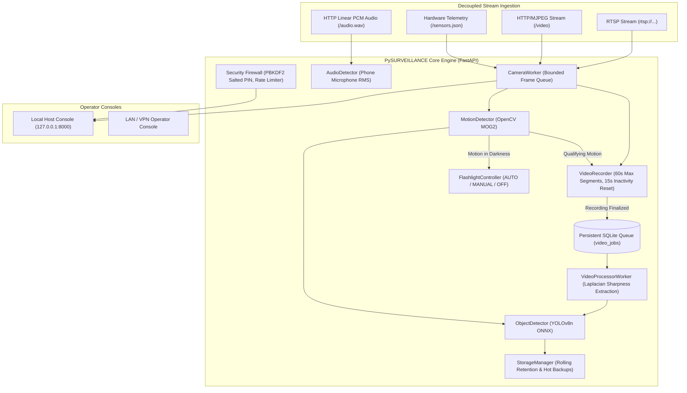

---

## Slide 4: Main Monitoring Dashboard (Command & Overview)
### Real-Time Security Operations Center (SOC) Command Console
The centralized command interface gives operators complete situational awareness: live stream preview, connection health, battery/power telemetry, acoustic indicators, and today's incident metrics.

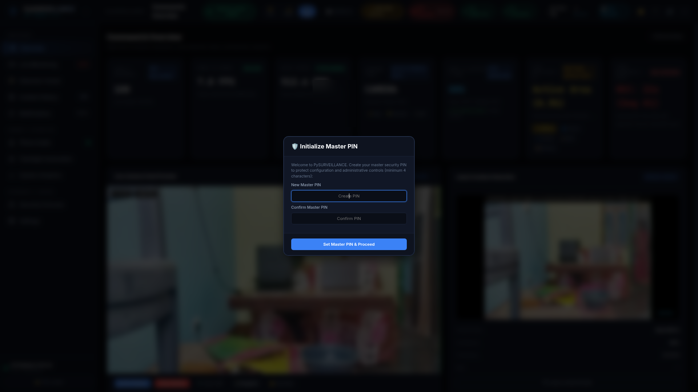

- **Live Stream Preview:** Sub-50ms MJPEG stream rendering with resolution and FPS telemetry.
- **Hardware Telemetry:** Real-time smartphone battery percentage, temperature, and AC/PoE status.
- **Quick Controls:** Immediate access to arming, night mode, flashlight overrides, and siren mutes.
- **Incident Summary:** Real-time event counter and recent multi-frame detection cards.

---

## Slide 5: Live Cinema Monitoring & Real-Time Alerts
### Full-Framerate Cinema Workspace & Floating HUD
Designed for focused perimeter observation, cinema mode presents a large live stream feed with floating detection alerts and non-intrusive software image enhancement controls.

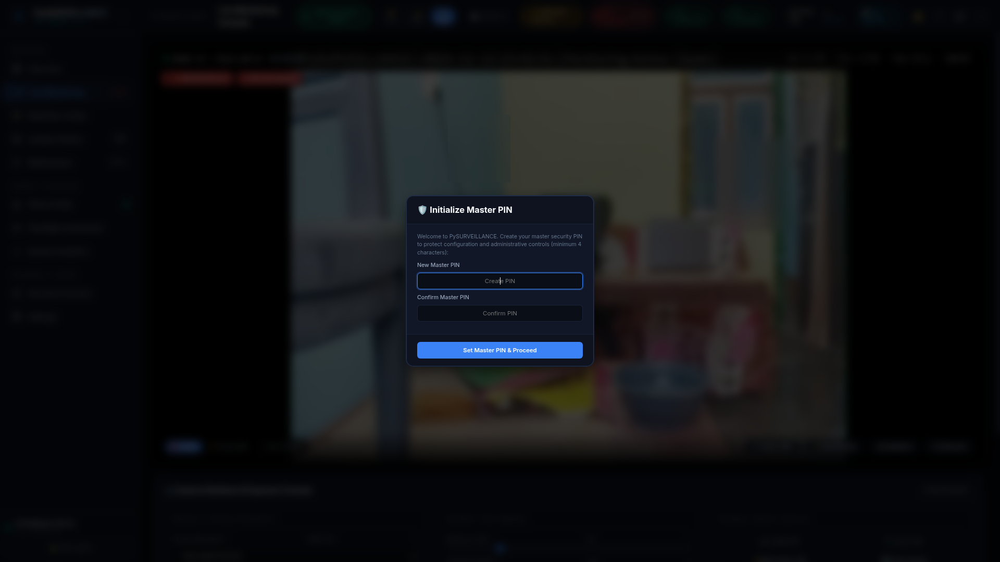

- **Floating Target Alerts:** Immediate visual notification (`🚨 PERSON 83% DETECTED`) without covering control bars.
- **Recording Status HUD:** Live badge showing recording time and active segment index (`● REC 00:18 (Seg #1)`).
- **Tone Mapping Controls:** Real-time gamma adjustment (0.5 – 2.0), brightness, contrast, and auto-HDR compensation for high-contrast backlit conditions.

---

## Slide 6: Neural Classification & Spatial Target Tracking
### YOLOv8n ONNX Deep Learning & OpenCV MOG2 Subtraction
The dual-engine architecture pairs rapid background subtraction with deep convolutional neural inference for high accuracy and minimal false alarms.

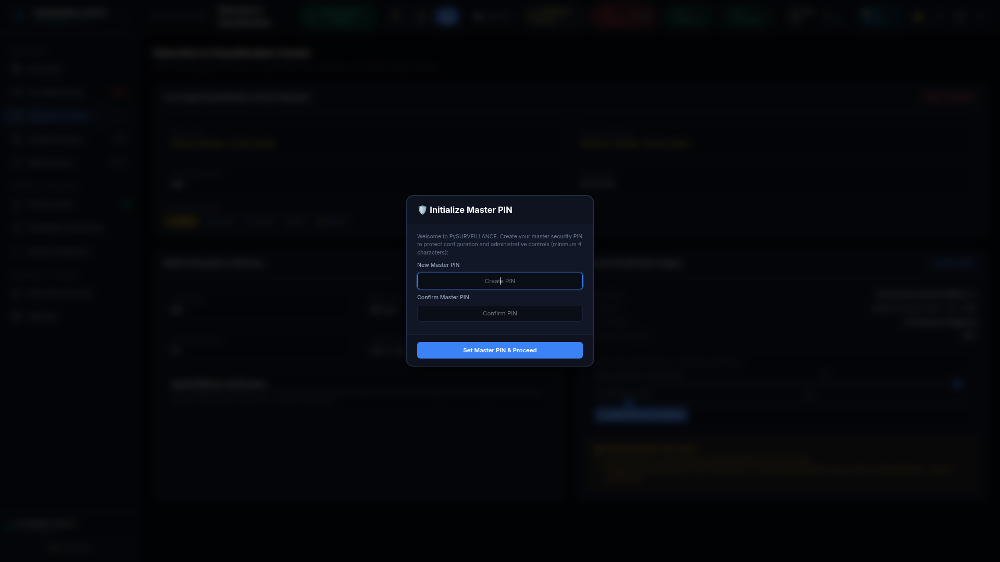

- **Real-Time Sensitivity Sliders:** Instant runtime tuning of MOG2 `VarThreshold` (motion sensitivity) and neural confidence cutoff (default 45%).
- **Spatial Overlap Verification:** Neural detections are strictly correlated against active visual motion bounding boxes to suppress static background false positives.
- **Hardware-Optimized Inference:** OpenCV DNN C++ backend running 1.5 FPS event-triggered inference with zero GPU hardware requirements.

---

## Slide 7: Motion-Triggered Video Recording & Segment Rollover
### Continuous Incident Capture Without Storage Blowout
Video recording starts instantaneously upon qualifying visual motion without waiting for neural inference to begin:

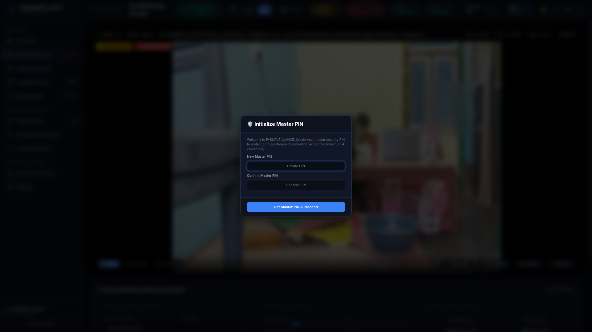

- **Immediate Motion Trigger:** Video capture begins on frame 1 of motion detection.
- **15-Second Inactivity Timer:** The countdown resets whenever qualifying motion recurs. If motion pauses for 10 seconds and returns, the same video recording continues.
- **60-Second Segment Rotation:** Long continuous events safely split into 60-second video segments under the same parent incident session, preventing memory leaks and infinite file growth.
- **Zero Footage Loss:** Seamless container rotation guarantees no frames are dropped during segment splits.

---

## Slide 8: Chronological Incident History & Event Records
### Deduplicated Multi-Frame Incident Sessions
The incident history view provides an audited, chronological record of every perimeter breach with severity classification, confidence scores, and multi-frame progression.

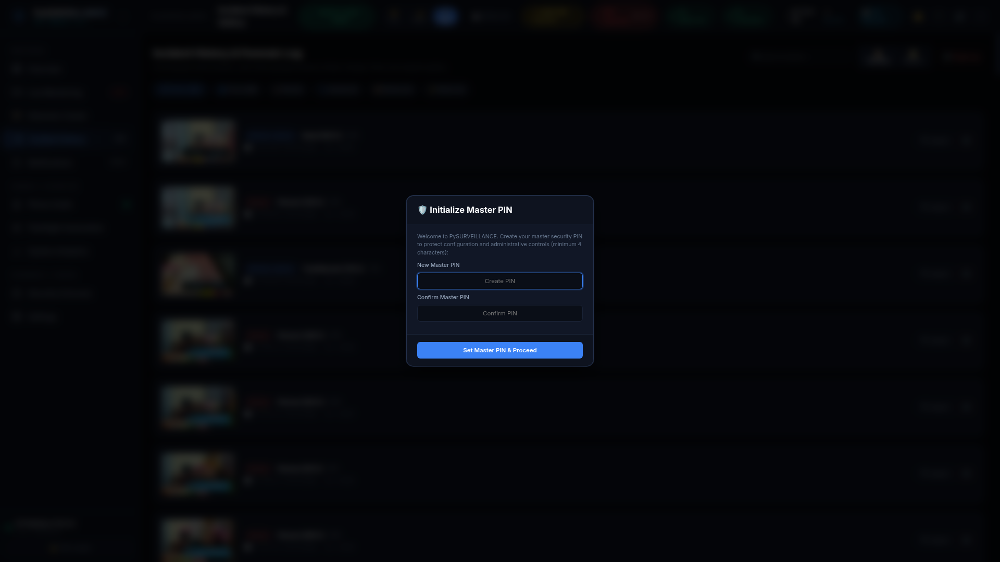

- **Three-Stage Event Capture:** Automatically records `Initial Trigger`, `Peak Change`, and `Final Concluding` frames for every incident session.
- **Dynamic Search & Filtering:** Filter by classification category (`Person`, `Animal`, `Bird`, `Possible monkey`, `Unknown object`), date range, or confidence score.
- **Acoustic Correlation:** Incidents record correlated microphone RMS energy and ambient lux levels at the exact moment of trigger.

---

## Slide 9: Visual Incident Gallery Grid
### Rapid Forensic Screening with Snapshot Cards
When investigating multiple events, the gallery view switches to a visual card grid for fast pattern identification and evidence browsing.

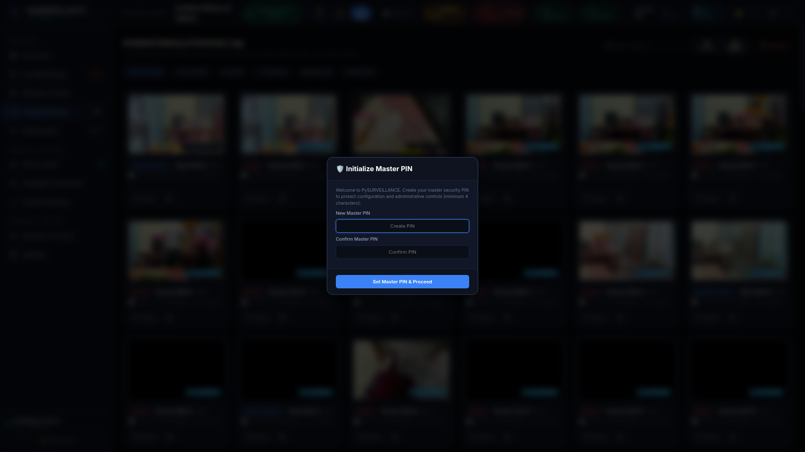

- **High-Density Card Grid:** Fast visual scanning of threat snapshots with category pill tags and timestamps.
- **Direct Download & Export:** Single-click full-resolution JPEG export with cryptographic metadata.
- **One-Click Forensic Inspection:** Click any card to launch the comprehensive forensic comparison modal.

---

## Slide 10: Asynchronous Video Processing & Forensic Frame Extraction
### Laplacian Variance Sharpness Scoring & Deep Forensics
After a recording segment closes, it is placed in the persistent SQLite queue (`video_jobs`). The background worker decodes frames and evaluates visual sharpness using Laplacian variance:

$$\text{Sharpness} = \sigma^2(\nabla^2 I) = \frac{1}{N} \sum_{x,y} \left( \nabla^2 I(x, y) - \mu \right)^2$$

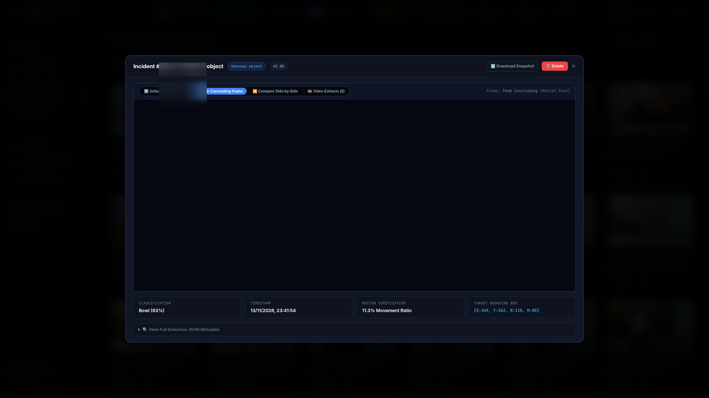

- **Decoupled Background Execution:** Video analysis runs completely independently without degrading live surveillance framerates.
- **Laplacian Variance Keyframes:** Eliminates motion-blurred frames, extracting only the sharpest representative snapshots.
- **Side-by-Side Comparison:** Compares initial trigger, peak change, final frame, and background video extracts within a single forensic modal.

---

## Slide 11: Acoustic Intelligence & Noise Floor Analysis
### Phone Microphone RMS Energy & Voice Detection
PySURVEILLANCE strictly accesses the camera's network audio stream (`/audio.wav`), isolating the laptop's internal microphone to prevent ambient room noise interference.

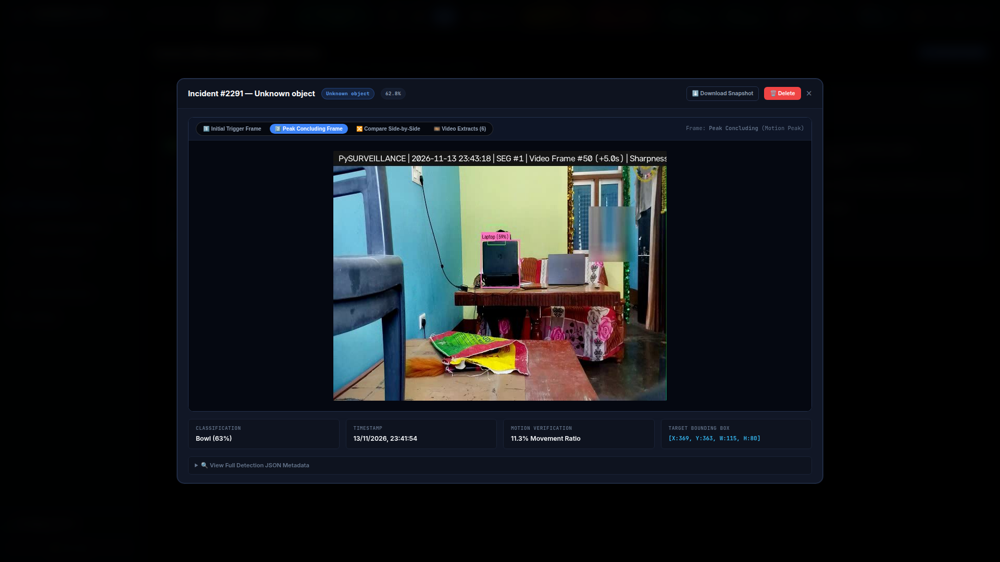

- **Dynamic Rolling Noise Floor:** Adaptive alpha filter tracks ambient background noise and detects true acoustic spikes.
- **Signal-to-Noise Ratio (SNR):** Continuous decibel/RMS evaluation triggers acoustic threat alerts only when sound exceeds background noise by a configurable factor.
- **Strict Network Audio Policy:** Linear PCM audio streaming over HTTP without writing unneeded ambient voice data to disk.

---

## Slide 12: Hardware-Adaptive Lighting Automation
### Darkness Detection & Motion-Triggered Illumination
Intelligent flashlight automation protects the perimeter by controlling hardware illumination when motion occurs in low-light environments.

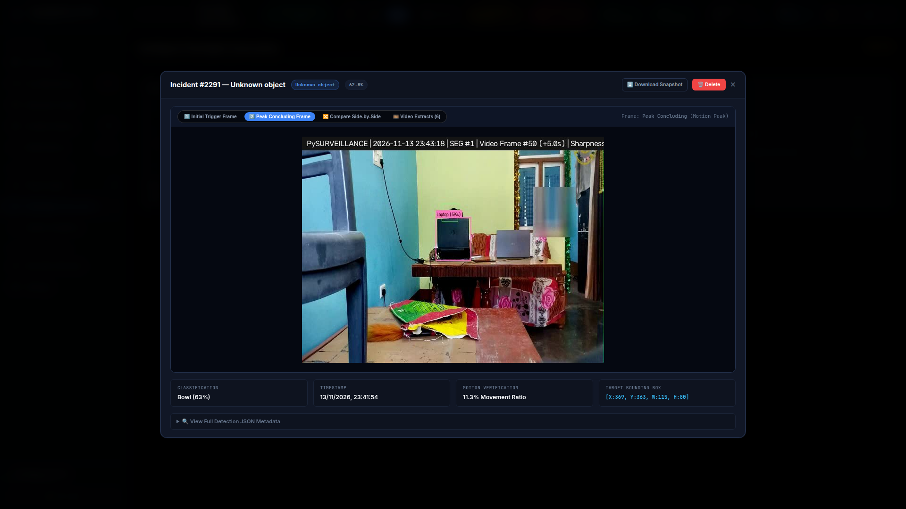

- **Ambient Lux Adaptation:** Automatically classifies scene lighting using camera exposure or ambient sensors (`lux_threshold: 45.0`).
- **Daylight Suppression:** Motion in daylight does NOT trigger lighting, saving power and avoiding false illuminations.
- **15-Second Inactivity Countdown:** Illumination remains active while motion continues and cleanly turns off 15 seconds after motion ceases.
- **Manual Overrides:** Immediate `FORCE ON` and `FORCE OFF` controls for maintenance or testing.

---

## Slide 13: Instant Notification Delivery & Deterrence
### Native Device Notifications & Audible Deterrent Sirens
Security breaches require immediate human response. PySURVEILLANCE integrates instant desktop push alerts with host-side acoustic deterrence.

- **Desktop & Mobile Push:** Service Worker push notifications deliver threat alerts with snapshot thumbnails directly to operator notification centers.
- **Host Laptop Speaker Siren:** Automatically plays synthesized deterrent tones via `paplay` / `aplay` upon verified `Person` or `Animal` breaches.
- **Configurable Class Cooldowns:** Enforces per-category acoustic cooldowns (30s for Person, 20s for Animal) to prevent alarm fatigue.

---

## Slide 14: System Diagnostics, FPS Benchmarks & Hardware Telemetry
### Resource-Conscious Performance on Modest Hardware
Designed to operate reliably on low-power edge machines, mini PCs, and laptops without overheating or resource starvation.

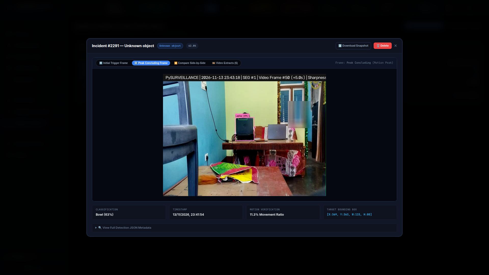

- **FPS Benchmarks:** Real-time tracking of camera acquisition FPS (10-15 FPS) vs. neural inference FPS (1.5 FPS).
- **CPU & RAM Telemetry:** Live process and system memory utilization graphs with automatic CPU throttling when host CPU > 85%.
- **Storage Retention Quotas:** Rolling automated cleanup maintains disk usage within configured quotas (e.g., 2048 MB) while strictly preserving active ongoing incidents.

---

## Slide 15: Camera & Audio Stream Configuration
### Decoupled Protocols & Hardware Independence
PySURVEILLANCE eliminates vendor lock-in by supporting industry-standard network protocols across video and audio.

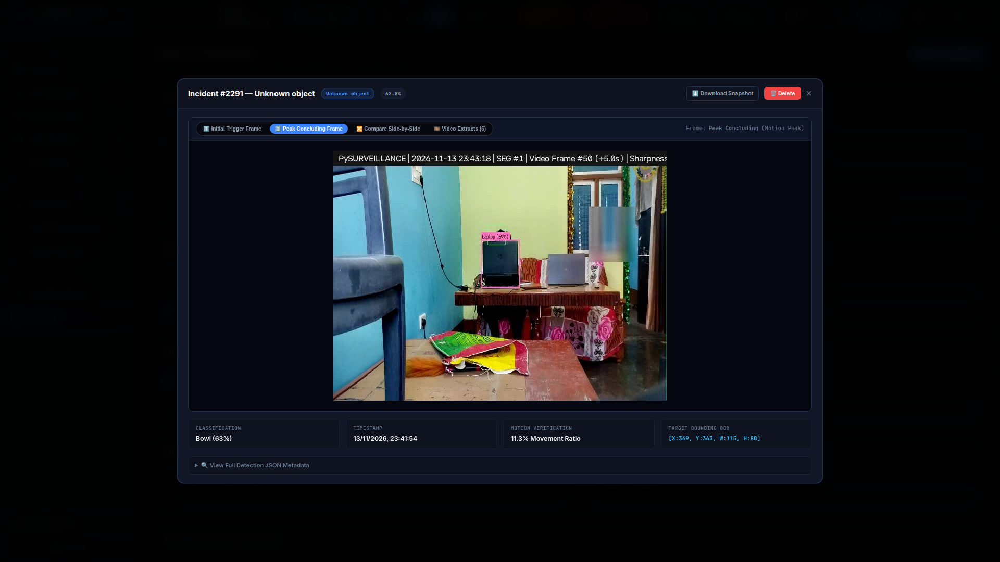

- **Standard Video Protocols:** Seamless ingestion of RTSP H.264/H.265 streams via OpenCV `VideoCapture` or multipart HTTP/MJPEG streams.
- **Independent Audio Stream:** Audio streams separately via uncompressed HTTP linear PCM/WAV (`/audio.wav`).
- **Hardware Profile Adaptability:** Supports `auto`, `ip_webcam` (for Android smartphone hardware controls), and `generic` (for standard ONVIF / RTSP IP cameras).

---

## Slide 16: Cryptographic Zero-Trust Security & Network Firewall
### Zero Default Backdoors & Private Network Isolation
Built from the ground up to prevent unauthorized remote access, automated scanning, and credential exposure.

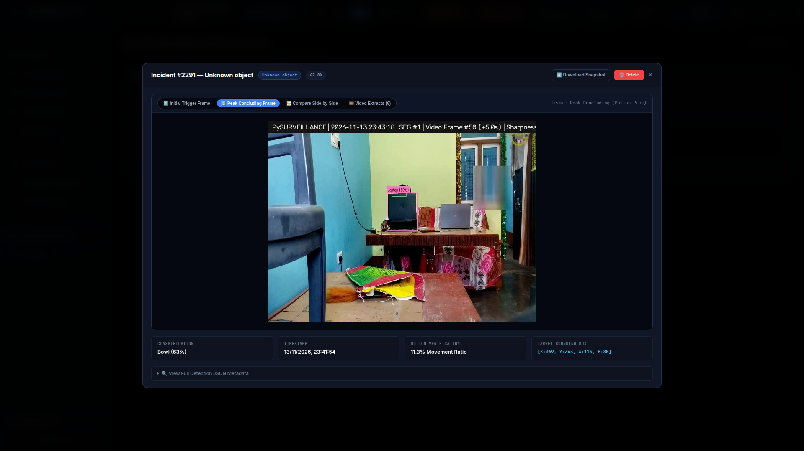

- **PBKDF2-HMAC-SHA256 Hashing:** Master PIN is salted with 16 cryptographically secure bytes and hashed across 100,000 iterations.
- **Brute-Force Rate Limiting:** 5 consecutive failed authentication attempts automatically trigger a 300-second IP lockout (HTTP 429).
- **RFC 1918 LAN Isolation:** Rejects all public internet traffic by default (HTTP 403), restricting access strictly to private subnets (`192.168.0.0/16`, `10.0.0.0/8`, `172.16.0.0/12`) and loopback (`127.0.0.1`).
- **Untracked Local Config:** Runtime secrets and PIN hashes are excluded from Git tracking via `.gitignore`.

---

## Slide 17: Ethical Surveillance & Privacy Architecture
### Security Without Compromising Human Rights
PySURVEILLANCE adheres to strict ethical engineering standards:

1. **Zero Facial Recognition:** Biometric face classification, facial embedding, and individual identification algorithms are completely disabled. Detections report strictly as generic `Person` entities.
2. **Privacy Sanitization:** Human faces in public documentation and presentations are automatically obscured with Gaussian blur.
3. **Animal Classification Integrity:** Standard COCO models cannot verify specialized species; untrusted animal detections report strictly as *"Animal detected — species unconfirmed"*.
4. **Zero Ambient Audio Storage:** Audio streams are processed strictly in-memory for acoustic energy telemetry. Zero continuous ambient voice audio is ever written to disk.

---

## Slide 18: Summary & Technical Highlights
### PySURVEILLANCE Platform Capabilities
- ✅ **Decoupled Architecture:** Asynchronous video recording and background keyframe extraction.
- ✅ **Neural Edge Inference:** YOLOv8n ONNX deep learning running smoothly on standard CPUs.
- ✅ **Smart Hardware Automation:** Ambient lux-aware flashlight control with 15s inactivity reset.
- ✅ **Dual-Stage Forensics:** Multi-frame snapshot capture + Laplacian variance video extractions.
- ✅ **Acoustic Intelligence:** Adaptive noise floor and RMS telemetry via network audio.
- ✅ **Hardened Security:** PBKDF2 salted authentication, brute-force lockout, and LAN firewall.
- ✅ **Complete Hardware Independence:** Works with smartphones, generic IP cameras, or RTSP feeds.
